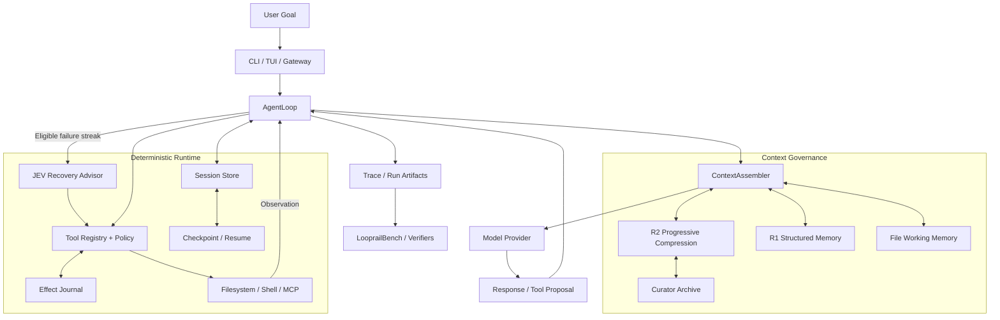

<div align="center">

# Looprail

**BUILD WITH CONTEXT · 让代码智能体持续推进任务**

面向真实代码仓库长链路开发任务的 Local-first Coding Agent Harness

[](https://www.python.org/)
[](https://github.com/Morimi-Kazuha/Looprail-Agent)
[](LICENSE)

[English](README.en.md) · [技术文档](docs/) · [评测体系](benchmarks/looprailbench/) · [Issues](https://github.com/Morimi-Kazuha/Looprail-Agent/issues)

</div>

## 项目介绍

Looprail 是一个在本地代码仓库中运行的 Coding Agent Harness。它把模型接入、工具执行、上下文治理、分层记忆、任务恢复和运行评测组织进同一条可审计的 Agent Loop，让任务能够沿着“检查仓库 → 调用工具 → 修改代码 → 执行测试 → 观察结果 → 继续决策”的闭环推进。

> **模型负责提出行动；Runtime 负责决定行动能否执行，以及如何约束预算、验证证据和恢复状态。**

项目重点处理真实长链路开发中的六类问题：上下文持续膨胀、跨 Session 重复读取、文件变化导致历史观察失效、失败或中断后的安全恢复、模型工具调用的权限边界，以及执行过程难以审计。Looprail 基于已有开源框架持续迭代；上游来源与修改范围保留在 [NOTICES.md](NOTICES.md)，不把继承能力全部描述为自主原创。

## 功能概览

| 能力 | 解决的问题 | Runtime 边界 |
| --- | --- | --- |
| Agent Harness | 将模型、工具、Session 与仓库任务连接成统一循环 | 模型提出下一步，Runtime 负责校验、执行与记录 |
| R2 Context Compression | 长任务历史和工具结果挤占上下文窗口 | 五阶段渐进压缩，预算达标即停止，原文进入可恢复归档 |
| R1 Structured Memory | 跨 Session 重复解释用户偏好和项目背景 | 结构化 Capture、作用域验证、去重与可选 ID 筛选 |
| File Working Memory | 已读取文件在后续 Session 中重复进入上下文 | 以完整 SHA-256、实际行区间和原文摘录重新校验 |
| Recovery & Tool Safety | 中断、失败和未知副作用可能造成危险重放 | Checkpoint、Effect Journal、权限边界与保守 Resume |
| JEV Recovery Advisor | 连续工具失败后缺少有界的语义恢复建议 | 闭集建议经过 Policy Guard；Runtime 始终保留执行权 |
| Trace & LooprailBench | Agent 行为难以复盘，收益容易被演示误导 | 运行 Trace、确定性合同、独立 Verifier 与证据门禁 |

## 核心能力

### Agent Harness：推理与执行解耦

`AgentLoop` 负责 Provider 与工具调用循环；`ContextAssembler` 在每轮调用前组合系统约束、历史、记忆、技能与当前任务；`ToolRegistry` 解析工具、校验参数、应用超时并规范化结果。文件工具在配置的工作区边界内解析路径，Shell 通过注入的 Executor 执行。

模型返回的工具名和参数只是**提议**。未知工具、非法参数、越界路径与策略不允许的调用会在实际执行前失败；成功或失败的观察再进入下一轮模型决策。这个边界使模型可以处理开放式问题，同时让 Runtime 掌握权限、预算和可验证事实。

### R2：五阶段渐进式上下文压缩

R2 默认接入统一的 `ContextAssembler` / Curator 路径。它不在一开始就要求模型总结全部历史，而是根据单项大小和完整输入预算逐级处理；任一阶段达到预算后立即停止。

| 阶段 | 核心处理 | 保留与回退 |
| --- | --- | --- |
| 1. Tool Result Offloading | 超长工具结果归档后以有界摘录进入 Provider 上下文 | 保留调用关系、失败证据与归档引用 |
| 2. History Snip | 裁去低相关或重复的旧完整交互 | 保护用户原文、近期交互、修改与失败证据 |
| 3. Microcompaction | 压缩较旧、重复的工具观察 | 不破坏 tool call / result 配对 |
| 4. Context Collapse | 将已闭合的旧交互折叠为确定性工作状态 | 保留约束、改动、测试、阻塞项与下一步 |
| 5. Auto Compaction | 前四阶段不足时生成八字段结构化摘要 | 只接受可回指原文的候选；非法、超时或无收益即拒绝 |

摘要不能覆盖用户约束，也不能把失败改写成成功。压缩后的上下文仍要通过结构与预算门禁，任务才能继续；原文保存在 Session 绑定的 Archive 中，并可通过受控 Reader 恢复。确定性演示记录了 **7,769 → 3,023 估算 Token**，但这只是一个使用 Fake Provider 的受控场景，不是生产任务平均节省。详见 [R2 设计与验证](docs/context-compression-r2.md) 和 [演示工件](docs/context-compression-r2-demo.json)。

### R1：结构化长期记忆

R1 在真实 Turn 已保存后执行可选 Capture，将明确的长期信息归入四种用途：

- `user`：稳定偏好或明确要求记住的用户信息；
- `feedback`：用户对 Agent 后续行为的明确纠正；
- `project`：用户声明的长期项目背景或决策；
- `reference`：用户指定、供后续使用的资料线索。

模型可以提出候选与引用原句，但 Memory 正文、作用域、来源、验证等级和冲突键由 Runtime 构造。`MemoryStore` 负责去重与版本替代；新 Session 先按 Repo / Project / User 范围确定性召回，再可选地让轻量模型只选择已有 Memory ID。非法 ID、重复 ID、超时或异常输出都会回退到原确定性结果，模型不能伪造记忆正文或把声明升级为已验证事实。

自动 Capture 与小模型 ID 筛选均**默认关闭**；未显式指定筛选模型时会使用当前 Provider 默认模型，因此希望控制成本时应明确配置轻量模型。详见 [R1 设计与测试](docs/memory-r1.md)。

### File Working Memory：带版本的文件观察

File Working Memory（FWM）记录可信内置 `read_file` 的真实观察，而不是长期项目知识。每条记录包含仓库与访问作用域、规范化相对路径、完整 SHA-256、文件字节与行数、实际返回行区间和有界原文摘录。复用前 Runtime 会重新打开文件、拒绝链接或重解析路径、校验完整 Hash 与逐行摘录；文件已变更、不可读或超出预算时不会注入。

它与 R1 / R2 的职责不同：R1 保存较长期的结构化知识，R2 维持当前任务状态，FWM 保存特定文件版本的读取证据。FWM **默认关闭**；跨 Session 能力当前只在 Windows 本地单用户 CLI、外部 Host State 且通过 Windows SID / ACL 检查的范围内验证。TUI、Gateway、非 Windows、映射盘和任意 `--workspace` 组合不声明同等支持。

一组真实 Provider A/B 验证了证据进入后续 Session，两个独立 Verifier 均通过；但目标 `billing.py` 两组都读取一次，开启组的 Session B Token 与费用反而上升。完整 Trial 的下降受 Prompt Cache 与行为差异混杂，不能归因于 FWM。因此当前不宣称稳定减少读取、Token 或费用。详见 [安全与配置](docs/file-working-memory.md) 和 [完整评测](docs/file-working-memory-evaluation.md)。

### Session、Checkpoint 与工具安全治理

Session 持久化对话与运行元数据；交互式路径默认可在每个 Turn 生成独立于用户仓库 `.git` 的 shadow-git Checkpoint。`--continue` / `--resume` 会基于持久化状态构造新的恢复提示，而不是把旧模型总结当作任务已经成功的证明。

工具执行通过 Registry 的声明式 Effect 分类进入 Journal：

```text
Provider ToolCall
  → 参数与工作区校验
  → PREPARED → RUNNING
  → COMMITTED / FAILED / UNKNOWN
  → Observation → AgentLoop
```

`READ`、`LOCAL_WRITE`、`EXECUTE` 与 `EXTERNAL` 使用不同的证据语义。已经启动但结果不确定的外部或执行型调用会保持 `UNKNOWN`：Runtime 不会自动重放未知副作用，也不会因模型说“完成了”就把它改写成成功。默认 Direct Executor 是带 allow / deny、工作目录和最佳努力路径检查的主机执行边界，**不等价于完整 VM 沙箱**。详见 [Tool Runtime Contract](docs/tool-runtime-contract.md)。

### JEV：受控语义恢复顾问

JEV 只在同一工具连续硬失败、仍有迭代预算且本轮尚未请求建议时介入：

```text
连续失败检测 → JEV 建议 → Schema / Confidence / Policy Guard → Runtime 决策
```

它只能建议 `RECHECK_INPUTS`、`USE_ALTERNATIVE` 或 `STOP`。本地 Policy 校验结构、闭集枚举、概率分布与置信度（默认阈值 `0.65`）；超时、缺少凭据、网络错误、非法响应或低置信度都会回到原确定性恢复。每轮最多调用一次。被接受的 `STOP` 会禁止本轮后续工具、生成无工具总结，并将状态保持为 `interrupted`，不会伪装成正常完成。

JEV **默认关闭**，是 Adaptive Recovery Advisor，不是所有任务都会经过的模型路由器，也不能绕过 Tool Registry、预算或权限。详见 [集成设计](docs/JEV_INTEGRATION.md) 与 [验证边界](docs/JEV_VALIDATION.md)。

### Trace 与评测

Tracing 默认开启，记录 LLM、工具、Memory、Session 与恢复路径中的关键 Span 和有界属性，用于本地审计。LooprailBench 则把确定性 Runtime 回归、Context / Tool / Memory 专项、独立 Verifier、预算账本与真实 Provider 实验分开管理。

当前公开证据应按以下边界理解：

| 证据 | 已验证内容 | 不能推出 |
| --- | --- | --- |
| Runtime baseline | Windows / Python 3.12 下的本地执行合同；支持清单记录 671 项 | 所有可选平台、外部服务或真实模型都已验收 |
| R2 确定性演示 | 五阶段接线、来源校验、预算门禁与压缩后继续执行 | 大规模真实任务的平均 Token 收益 |
| JEV Fake / 单次 live wiring | Policy、回退、STOP 与真实传输接线 | 恢复准确率或任务成功率提升 |
| FWM 单组真实 A/B | 跨 Session 证据注入、12 次真实请求、两组 Verifier 通过 | 稳定少读文件、降低 Token 或费用 |
| LooprailBench formal campaign | 运行工件、失败与负结果可重建 | `measurement_valid=false` 时的正向性能结论 |

不要把历史专项测试数字相加成“总测试数”，也不要把 Fake Provider 或单次演示解释为生产性能。入口与证据边界见 [LooprailBench](benchmarks/looprailbench/README.md) 和 [Evaluation Notes](docs/evaluation/README.md)。

## 系统架构



## 技术栈

| 层次 | 技术 | 用途 |
| --- | --- | --- |
| Runtime | Python 3.12, asyncio | Agent Loop、工具执行、Session 与恢复 |
| CLI | Typer, Rich, prompt-toolkit | 命令行、交互输出与输入 |
| Model | LiteLLM, HTTPX | 多 Provider 调用与受控适配器 |
| Contracts | Pydantic 2 | 配置、Tool Schema 与结构化结果校验 |
| State | JSON / JSONL, shadow Git | Session、Memory、Effect、Checkpoint 与运行工件 |
| Context | tiktoken, Curator / Trimmer | Token 估算、预算门禁与渐进压缩 |
| TUI | TypeScript / Node.js, Ink | 可选原生终端界面与 RPC Bridge |
| Quality | pytest, Ruff, LooprailBench | 确定性回归、静态检查与实验评测 |
| Packaging | uv, Hatchling | 可复现依赖同步与构建 |

## 本地运行

当前推荐从源码检出运行；`pyproject.toml` 要求 **Python >= 3.12, < 3.13**，并建议安装 [uv](https://docs.astral.sh/uv/)。

```bash
git clone https://github.com/Morimi-Kazuha/Looprail-Agent.git
cd Looprail-Agent
uv sync --frozen --extra dev --dev
uv run --frozen looprail --version
```

使用向导配置 Provider 与本地 Runtime。没有安装外部 Memory Backend 时，可使用 `--skip-memory`；它会关闭外部 Backend、R1 Auto Capture 与 Memory Selector，但不会删除已有本地记忆。

```bash
uv run --frozen looprail onboard --skip-memory
```

对本地仓库执行一次任务：

```bash
uv run --frozen looprail run --workspace "<repo-root>" -m "检查失败测试，做出最小安全修复，运行相关测试并总结证据。"
```

继续最近一次 CLI Session，或恢复指定 Session：

```bash
uv run --frozen looprail run --workspace "<repo-root>" --continue -m "继续上次未完成的任务。"
uv run --frozen looprail run --workspace "<repo-root>" --resume "<session-id>" -m "根据恢复证据继续。"
```

使用 `uv run --frozen looprail run --help` 查看完整参数。Provider Key 应仅通过本地配置或环境变量提供，不要写入仓库。

### 可选能力默认值

| 配置 | 默认状态 | 说明 |
| --- | --- | --- |
| `context.progressiveCompression` | 开启 | R2 五阶段渐进压缩 |
| `memory.autoCapture.enabled` | 关闭 | R1 Turn 后自动 Capture |
| `memory.rerank.enabled` | 关闭 | R1 小模型 Memory ID 筛选 |
| `fileWorking.enabled` | 关闭 | File Working Memory |
| `runtime.jev.enabled` | 关闭 | JEV Adaptive Recovery Advisor |
| `runtime.checkpoint.policy` | `interactive` | 仅交互式路径默认创建 Turn Checkpoint |
| `tracing.enabled` | 开启 | 本地运行 Trace；可由环境 Kill Switch 覆盖 |

## 测试与评测

Windows 上支持的确定性 Runtime 回归入口：

```powershell
.\scripts\run_runtime_baseline.ps1 -Python .\.venv\Scripts\python.exe
```

R2 专项与 README 中引用的确定性演示：

```powershell
uv run --frozen pytest -q tests/test_context_compression_r2.py
uv run --frozen python -m scripts.demo_context_compression_r2 --state ".looprail/r2-demo"
```

File Working Memory、JEV 与 LooprailBench 的专项命令、前置条件和证据限制分别记录在对应文档中。涉及真实 Provider 的命令可能产生费用；LooprailBench 的 paid path 有独立预检、预算上限与显式 opt-in，不属于默认测试。

## 项目说明

Looprail 当前适合本地研究、技术审阅、Agent Runtime 实验与作品集展示，尚不代表托管生产服务。现阶段限制包括：部分跨平台路径尚未达到 Windows CLI 的验证深度；FWM、R1 Capture / Selector 与 JEV 都保持 opt-in；默认 Direct Executor 不是安全隔离虚拟机；模型摘要、恢复建议和工具选择仍可能出错，因此确定性门禁与人工审阅不可省略。

Looprail 不以替代 Claude Code、Codex 或其他成熟 Coding Agent 为目标。它更关注一个可拆解、可验证的 Harness 问题：怎样让不确定的模型推理在清晰的 Runtime 权限、证据、预算和恢复契约中持续工作。

## License

Looprail 以 [Apache License 2.0](LICENSE) 开源。

项目包含或改编自 MIT 许可的开源项目；完整来源、版权声明与修改范围见 [NOTICES.md](NOTICES.md) 和 [LICENSES/](LICENSES/)。
